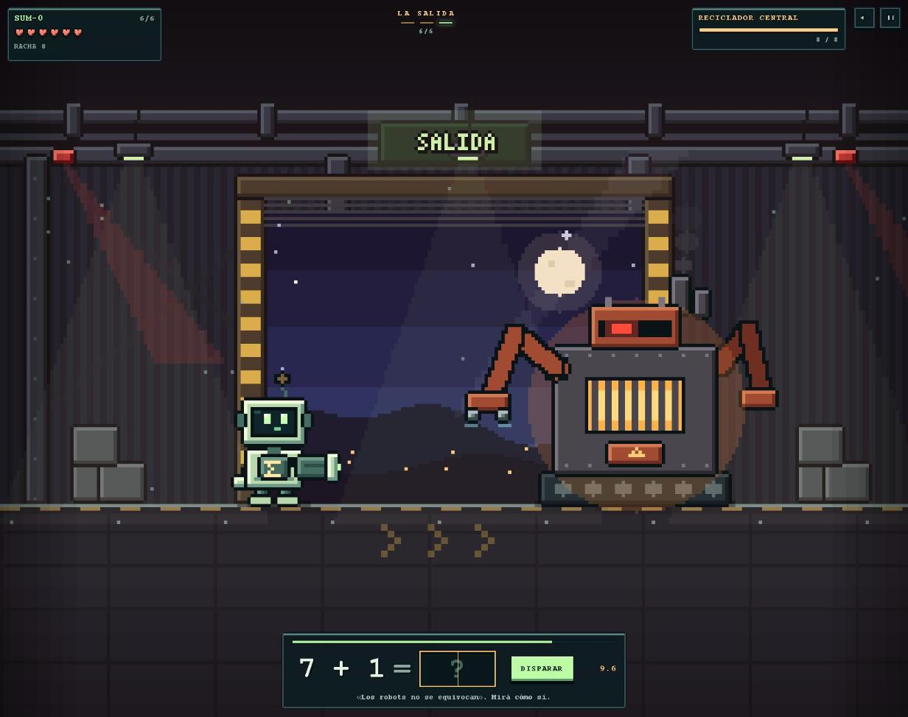
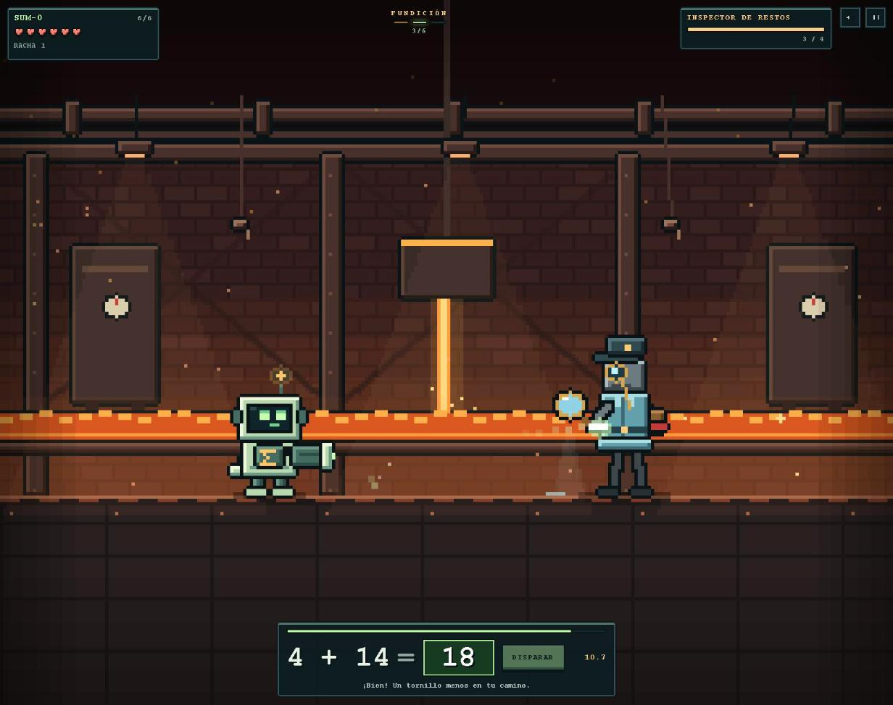

# SUM-0 — Error de fábrica

> 🚧 **Work in progress.** El código está abierto para verlo, pero por ahora no acepto contribuciones: issues y pull requests están cerrados a colaboradores.



## De qué se trata

SUM-0 es un robot recién salido de la línea de montaje con un problema: en el control de calidad le preguntan cuánto es 1 + 1 y contesta «¿tres?». El sistema central lo declara defectuoso y lo manda al triturador. SUM-0 se escapa colgado del borde de la trampa y decide salir de la fábrica, aunque tenga que aprender a sumar en el camino.

Cada combate es una suma contra reloj:

- **Acertás**: SUM-0 dispara su cañón y el enemigo pierde resistencia.
- **Te equivocás o se acaba el tiempo**: el enemigo contraataca y perdés vida, pero ves la respuesta correcta para la próxima.

Hay seis robots de la fábrica en tres zonas (Depósito, Fundición y La Salida), con sumas cada vez más grandes y menos tiempo:

- Un barrendero con malas intenciones.
- Un cangrejo cobrador de impuestos.
- Un inspector con monóculo.
- Un dron que cuenta tus errores.
- Un triturador que sueña con ser licuadora.
- El Reciclador Central, el jefe final.

Entre combate y combate armás tu propia combinación de módulos en un taller improvisado: escudo, reloj que congela el tiempo, combos, curación y un pulso de energía.

Es una partida corta de 3 a 5 minutos, con humor y pensada para que equivocarse sea parte del juego. Está escrito en JavaScript nativo y Canvas 2D: sin dependencias, sin recursos externos y sin backend. Todo el arte es pixel art original dibujado con código.



## Ejecutar

Requiere Node.js 18 o superior. No hace falta `npm install`.

```sh
npm run dev      # http://127.0.0.1:4187 (otro puerto: PORT=4188 npm run dev)
npm test         # 19 pruebas con el runner de Node
npm run build    # copia los recursos a dist/ para servirlos estáticos
```

Parámetros de desarrollo:

- `?gallery` muestra todos los personajes y sus poses animadas.
- `?round=N` (de 0 a 5) arranca la partida en ese encuentro.
- `?powers=shield,freeze,charge,combo,regen,battery` arranca con esos módulos instalados y el pulso cargado.

## Cómo se juega

- Escribí la suma y presioná Enter o **Disparar**. Un acierto hace 1 de daño; un error o el tiempo agotado te cuesta 1 de vida y muestra la solución.
- Seis enemigos en tres zonas (Depósito, Fundición y La Salida), con un jefe final. Una partida dura entre 3 y 5 minutos.
- Después de cada victoria hay un taller: dos módulos permanentes y una reparación.
- Teclas: Escape pausa, F congela el reloj y R arma el pulso, cuando están desbloqueados.
- La pausa se activa sola si se pierde el foco o se oculta la pestaña.

## Hecho

### Juego base
- Motor de combate separado de la vista (`engine.js`): dificultad progresiva, 7 mejoras, escudo, congelación, combos, curación y pulso cargado.
- Intro de 4 escenas a tu ritmo, que se puede saltar o volver a ver.
- Pausa, accesibilidad por teclado, foco atrapado en los modales y `prefers-reduced-motion`.

### Arte y animación (versión 2)
- **Pantalla completa**: el canvas ocupa todo y la interfaz va encima como HUD (vida, enemigo, ruta, suma). Se escala con píxeles enteros para que el pixel art quede nítido en cualquier tamaño.
- **SUM-0**: cara en una pantalla con 9 expresiones (normal, parpadeo, concentrado, feliz, dolido, preocupado, pensando, pánico y apagado), antena con resorte, respiración, cañón en el brazo que se carga, y poses de festejo, desplome, carrera y colgado.
- **Seis enemigos con silueta propia**:
  - Escob-01: tacho con rueda y escoba que barre.
  - Pinza fiscal: cangrejo con galera, ojos en antenas y un recibo.
  - Inspector de restos: monóculo, gorra y una lupa que escanea el piso.
  - Dron de inventario: hélices y un contador que corre.
  - Triturador junior: dientes que giran y un vaso de licuadora como sombrero.
  - Reciclador Central: horno con rejilla fundida, visor que escanea, chimeneas y brazos grúa con imanes.
- **Ataques propios de cada enemigo**: nube de polvo, tornillos, sello, láser, engranajes y metal fundido.
- **Efectos**: carga, disparo con estela, rayo de pulso, destello de impacto, retroceso, pausa de impacto, sacudida de cámara y números de daño en una fuente pixel propia. También chispas, humo, restos con rebote, entrada de cada enemigo, explosión al morir, confeti al ganar y humo al perder.
- **Tres zonas animadas**:
  - Depósito: cinta transportadora con chatarra y lámparas que titilan.
  - Fundición: crisol vertiendo metal, canal de lava, brasas y cadenas.
  - La Salida: portón abierto a la noche, con estrellas, estrella fugaz, reflector y alarmas en el jefe.
- **Interfaz**: íconos pixel en SVG para vida, módulos, sonido y pausa. Efectos de sonido distintos para acierto, golpe, bloqueo, explosión, victoria y derrota.
- El taller, la victoria y la derrota esperan a que termine la animación de muerte antes de aparecer.

### Verificación
- 19 pruebas automáticas. Incluyen recorrer partidas completas dibujando cada frame en tres tamaños de pantalla (paisaje, retrato y escritorio), además de la derrota, la congelación, el pulso, la pausa y el movimiento reducido.
- Revisado en Chrome: galería, intro, combate en las tres zonas y contra el jefe, taller, victoria (25 aciertos) y derrota. Sin errores en consola.
- Vista de celular de 390 × 844 revisada en un iframe: sin scroll horizontal.

## Falta

- Probar en un teléfono físico con teclado virtual. El iframe no simula el teclado que tapa la pantalla.
- Escuchar los efectos de sonido en un equipo real. Solo se verificó que no fallen.
- Música de fondo por zona.
- Guardar la partida o el progreso.
- Dificultad adaptativa: hoy los rangos de las sumas son fijos por enemigo.
- Más operaciones (restas, multiplicaciones) o modos de práctica.
- En retrato los personajes se ven chicos: se podría ajustar el encuadre para pantallas angostas.
- Reemplazar la fuente monoespaciada del sistema por una fuente pixel propia en el HUD.
- Publicarlo (itch.io o un hosting estático). Todavía no se publicó en ningún lado.

## Archivos

| Archivo | Qué hace |
| --- | --- |
| `engine.js` | Estados, sumas, dificultad, daño y mejoras. No depende de la vista. |
| `main.js` | Controles, HUD, sonido, pausa, escala del canvas y bucle de animación. |
| `art.js` | Escena de combate: fondos por zona, detección de eventos, efectos y partículas. |
| `actors.js` | SUM-0 y los seis enemigos, armados por piezas animables. |
| `pixel.js` | Primitivas de pixel art (bloques sombreados, discos, líneas y fuente 3×5). |
| `icons.js` | Íconos pixel en SVG para el HUD y el taller. |
| `story.js` | Intro cinematográfica. |
| `style.css` | HUD de pantalla completa y paneles. |
| `tests/` | Pruebas del motor, el controlador, la intro y el arte. |

Todo el arte es original y se dibuja con código: no hay imágenes ni recursos externos.
